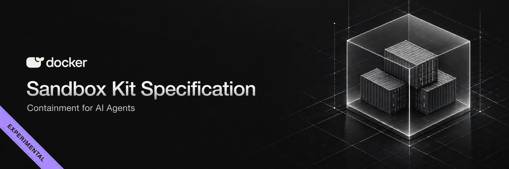

# Docker Sandbox Kit Specification v3

This repository holds the Kit v3 descriptor specification, its BuildKit
frontend, and two conformance suites: one checks a published Kit, the
other checks a runtime that claims to support Kits.

## From Dockerfile to Kit

A Dockerfile describes the software itself: how it is built, what gets
packaged, and how it starts (entrypoint, command, user, environment). A
decade of tooling grew up around that, because the same image builds,
pulls, and runs the same way on every machine that supports OCI images.

Agents don't fit that model. A container isolates an application, which
runs, does its job, and touches only what it was handed. An agent is an
actor: it decides what to do next and then does it to your filesystem,
your network, your databases, and your cloud account, using authority
you granted on purpose.

The agent needs that authority. One that cannot install a dependency,
reach an API, or hold a credential cannot do its job. But each grant
gives up some of the isolation you were counting on, so the more useful
an agent gets, the less its container isolates it.

So the boundary has to move out from the container to the
**containment**: the machine, the filesystem, the network, the
credentials, everything the agent can reach or change. A sandbox gives
the agent its own kernel, so that part of the boundary is enforced by
the machine instead of agreed to by the model. An empty sandbox still
isn't a working environment, though. Something has to say which harness
runs, which tools and MCP servers it gets, which skills and instructions
it loads, and exactly what it may touch.

A Dockerfile doesn't answer any of that. It specifies the inside of the
image completely and the outside not at all, so the rest has lived in
`docker run` flags, a Compose file, a CI config, an onboarding doc, and
whatever the person who set it up still remembers. None of it is in the
artifact, and none of it is versioned or reviewed. A Kit puts it there:
the content and the authority it asks for, in one image, under one
digest.

That makes authority **diffable**. When the next version of an agent
asks for another credential or another network destination, that is a
change in authority. It shows up in the diff, it can be held for
approval, and it travels with the Kit wherever the Kit runs. It is also
why Kits are a specification and not a product feature. A Kit has to
keep working when you run it somewhere else, or it is lock-in.

**Dockerfiles made software reproducible. Kits make authority reproducible.**

> [!IMPORTANT]
> **This specification is experimental.** It is published so people can
> use it and argue with it, and it will change as implementers find gaps.
>
> Changes are meant to be additive, which is why each capability type
> carries its own version. A contract that has to change ships as `@2`
> next to the existing `@1`, both stay published, and a descriptor names
> the version it was written against, so Kits that resolve today should
> keep resolving. Bumping the descriptor-wide `schemaVersion` is the last
> resort, for changes a new type version cannot express.
>
> A final version is planned for **Q4 2026**, after community feedback.
> If a Kit you want to write cannot be expressed, or a runtime duty is
> stated in a way you cannot implement or check, please
> [open an issue](https://github.com/docker/sandbox-kit-spec/issues/new/choose).

## What a Kit is

A Kit packages one piece of a working environment, such as a tool, an
agent, or a service, so that a runtime can install it, grant it what it
needs, and combine it with other Kits without knowing anything about it
in advance.

There is no Kit media type, artifact type, or sidecar file. A Kit is a
single OCI image: the manifest annotation
`vnd.docker.sandbox.kit.descriptor` carries the Kit's **declarations**,
and the layers carry its **content**.

So a Kit pulls with `docker pull`, inspects with `regctl`, and works as a
`FROM` base like any other image. A registry that has never heard of Kits
stores one correctly, and an engine that ignores the annotation runs it
as an ordinary image. The declarations ship in the same artifact as the
content, under the same digest, so there is no second file to find or
keep in sync.

### Two kinds

| Kind | Its layers are | Per composition |
|---|---|---|
| `workload` | A root filesystem. The image config supplies entrypoint, cmd, env, user, workdir. | Exactly one |
| `mixin` | An overlay that lands on the workload's filesystem. May carry no content at all and only declare. | Zero or more |

A workload is the thing that runs. Mixins add to it: a CLI, a credential
binding, a network rule, or context for an agent.

## Tenets

Most rules in the specification apply one of these principles to a
specific case.

**Ride the ecosystem, don't extend it.** A Kit adds no media type,
artifact type, or sidecar file, so every registry, scanner, signer, and
mirror already handles one correctly. A new artifact format is cheap to
write; the cost is the decade of tooling that does not understand it.

**One artifact, one digest.** Declarations live in the manifest of the
image they describe, so a Kit cannot be half-updated: pinning the digest
pins the policy, the content, and the metadata together. A separate file
describing an image is a second source of truth, and second sources
drift.

**Declare only what images cannot already express.** The descriptor has
no top-level identity name, no image reference, and no entrypoint or
env. A Kit's identity is the reference you consume it by, and
capability-entry names are display labels. The runtime contract is the
image config. Restating identity or runtime config would give two
answers to one question, and one of them would go stale.

**One model for every ask.** Resource grants and engine-executed
behaviors are the same kind of request: a typed, versioned entry in
`capabilities`. A host reviews one list to decide what a Kit may do, and
a Kit has one way to ask. Whether a host supports something is a single
question, not a patchwork of unrelated fields.

**Fail closed, and fail early.** Unknown descriptor fields are errors,
an unsatisfied requirement stops resolution, and a required capability
the host cannot grant refuses the launch. A permission dropped silently
looks the same as one never requested, and the failure would show up
later as wrong behavior instead of as an error.

**Composition is a function, not a sequence.** A resolved Kit set is
ordered by its dependency graph, not by the order the arguments were
typed, so the same set always composes to the same image. That is what
lets a composition be locked, reproduced, and cached.

**The grammar declares; runtimes behave.** The descriptor says what is
wanted and never how a host provides it. That is why the capability
pages, and not the grammar, are normative for runtime behavior. A host
that cannot implement a capability refuses it instead of approximating
it.

**Let types evolve on their own clock.** The `@1` in a capability type
versions its contract: the config schema and observable behavior,
including composition rules and permitted transitions against persistent
state. A capability can change without a descriptor grammar bump, and
hosts can support types the grammar has never heard of.

For a worked tour of a real Kit, its capabilities, and how a set
composes, see [docs/kit-intro.md](docs/kit-intro.md).

## Layout

- `docs/spec/SPEC-v3.md`: the normative specification. It covers the
  descriptor grammar and the OCI layout, and has one page per well-known
  capability type describing what a supporting runtime must do.
- `spec/`: descriptor types, strict decoding, validation, arg expansion,
  and capability/version parsing. Import it as
  `github.com/docker/sandbox-kit-spec/v3/spec`. This package is the single
  source of truth for the grammar, and the Docker Sandboxes runtime
  imports it to read published Kits.
- `schema/kit.schema.json`: the descriptor grammar as a JSON Schema, for
  validation and completion in editors. To use it with
  yaml-language-server, add a modeline on the descriptor's second line
  (the `# syntax=` line must stay first):

  ```yaml
  # syntax=docker/sandbox-kit:3
  # yaml-language-server: $schema=https://raw.githubusercontent.com/docker/sandbox-kit-spec/main/schema/kit.schema.json
  ```

  The Go validator is still the validator of record. `spec/schema_test.go`
  checks the schema's constants (need types, enums, field regexes)
  against the spec package, so the two can't drift apart unnoticed.
- `schema/capabilities/`: one schema file per well-known capability
  type, named after the type (`com.docker.sandbox/volume@1.schema.json`).
  The `@version` in a need type names an addressable config schema, and
  these files are those schemas. Each type owns its config shape, and
  `kit.schema.json` references them. Config-less types (`privileged@1`,
  `kit-registry@1`) reject any config value. The author of a
  host-specific type publishes the equivalent under their own namespace.
- `cmd/frontend/`: the BuildKit gateway frontend that the descriptor's
  first line, `# syntax=docker/sandbox-kit:3`, dispatches to. It is a
  separate Go module so library consumers don't pull in BuildKit
  dependencies.
- `skills/`: agent skills, not tied to any one agent tool, for writing a
  v3 Kit and migrating a v2 one. [skills/README.md](skills/README.md)
  explains how to wire them into an agent.

## How to get started

These steps go from running a published Kit to the local edit-and-run
loop. Running Kits takes the `sbx` CLI (public install via
[Docker Docs](https://docs.docker.com/ai/sandboxes/install/) /
[sbx-releases](https://github.com/docker/sbx-releases)). The current
stable `sbx` release supports Kits v3 in both local and cloud mode
(`sbx run …` and `sbx --cloud …`). Cloud sandboxes use the same Kit
references but do not mount a host workspace.

Published Kits are ordinary images in registries. Verified Publisher
Sandbox Kits are listed on
[Docker Hub](https://hub.docker.com/search?type=sbx_kit&badges=verified_publisher).
The `docker` org publishes **v3** Kits (this specification). The `sbx`
org still carries the older **v2** line, so don't mix the two. You can
also write your own from this checkout.

**1. Install `sbx`.**

```sh
# macOS
brew trust docker/tap
brew install docker/tap/sbx

# Windows
winget install -h Docker.sbx

# Ubuntu (sbx only; or use SBX=1 with get.docker.com for Engine + sbx)
curl -fsSL https://get.docker.com | sudo REPO_ONLY=1 sh
sudo apt install docker-sbx
sudo usermod -aG kvm $USER
# re-login (or: newgrp kvm) so /dev/kvm is usable before sbx run

# Or download platform artifacts from
# https://github.com/docker/sbx-releases/releases
sbx login
```

The frontend needs no install:
[`docker/sandbox-kit:3`](https://hub.docker.com/r/docker/sandbox-kit) is
on Docker Hub, and BuildKit pulls it when it reads the `# syntax=` line.

**2. Run a published Kit.** This needs no build and no push. It composes
a workload with a mixin from the `docker` org:

```sh
sbx run docker/sbx-kit-shell:1.0.0 --kit docker/sbx-kit-claude-mixin:2.1.281 .
# same references in cloud (no local workspace path):
# sbx --cloud run docker/sbx-kit-shell:1.0.0 --kit docker/sbx-kit-claude-mixin:2.1.281
```

`shell` is a minimal workload; `claude-mixin` overlays Claude Code onto
it. For workloads built from distribution images, see
[`ubuntu-docker`](examples/ubuntu-docker/README.md) and
[`ubi-docker`](examples/ubi-docker/README.md): Ubuntu 24.04 and Red Hat
UBI 9.6 with Docker Engine, Buildx and Compose, including the startup
compatibility setup for sbx 0.50.1. More v3 Kits from the `docker` org
are on
[Docker Hub](https://hub.docker.com/search?type=sbx_kit&badges=verified_publisher)
(filter to that org; `sbx/*` there is still v2).

**3. Push the hello Kit and run it.** From here on you build Kits from
this checkout. The sandbox runtime resolves Kit *images* from
registries, so an image that exists only in Docker Desktop's local store
cannot run. Push to a namespace you own (Docker Hub works), or use Kit
*directories* (step 6), which need no registry at all.

Set your registry namespace once and log in:

```sh
export KIT_REGISTRY=docker.io/<your-hub-username>
docker login
```

`hello` is the smallest workload Kit: a full agent environment with a
startup hook, guidance, and a network policy. `task kit:push` builds
`examples/hello` with the Kit frontend and pushes it as an ordinary
image:

```sh
task kit:push KIT=hello TAG=1.0.0 REGISTRY=$KIT_REGISTRY
sbx run $KIT_REGISTRY/sbx-kit-hello:1.0.0 .
```

Inside the sandbox, the Kit describes itself:
`cat /usr/share/sandbox/kit/hello/kit.yaml` shows the published
descriptor, `kit.dockerfile` next to it is the recipe that produced the
content, and `cat /var/log/sbx-kit-startup.log` shows the startup hook's
run. `task kit:build KIT=hello` builds without pushing. That helps while
you iterate on a descriptor until it validates, but `sbx` can't run the
result until it is pushed or used as a directory.

**4. Add the tool Kit (composition).** `tool` is a content-bearing mixin
that `requires` hello. The resolver checks that the set is coherent and
orders the provider before the requirer, and the assembler merges the
layers into one image. The lock caches that image, so the second run
reuses it.

```sh
task kit:push KIT=tool TAG=1.0.0 REGISTRY=$KIT_REGISTRY
sbx run $KIT_REGISTRY/sbx-kit-hello:1.0.0 --kit $KIT_REGISTRY/sbx-kit-tool:1.0.0 .
```

`cat /time.txt` inside the sandbox shows that tool's startup hook ran on
hello's filesystem.

**5. Add the gh Kit (binary content).** `gh` is a mixin whose overlay
carries the GitHub CLI as a pinned Nix closure, plus a phased network
policy and a proxy-managed credential. Composing it puts a real binary
into the workload's filesystem:

```sh
task kit:push KIT=gh TAG=2.72.0 REGISTRY=$KIT_REGISTRY
sbx run $KIT_REGISTRY/sbx-kit-hello:1.0.0 --kit $KIT_REGISTRY/sbx-kit-gh:2.72.0 .
```

Inside, `gh --version` works (`/usr/local/bin/gh` resolves into the
overlay's `/nix/store`). With a `github` secret bound on the host
(`sbx secret set github`), `gh api user` authenticates through the
proxy, and the container only ever sees a sentinel token.

**6. The local loop: no registry, no push.** Point `sbx run` at Kit
directories and the runtime builds them on demand, keyed by source hash,
and loads the results straight into the sandbox runtime:

```sh
cd examples
sbx run ./hello --kit ./gh .
```

Edit `hello/hello.yaml` (say, add an allow entry) and re-run: only hello
rebuilds, and unchanged Kits come from the cache. Local builds from a
recipe use host Docker Buildx when Docker is available, and a dedicated
builder sandbox otherwise. Declaration-only mixins need neither.
`SBX_KIT_BUILDER=host` or `SBX_KIT_BUILDER=sandbox` picks one
explicitly. `sbx kit builder status`, history, and removal cover only
the sandbox backend; removing it does not free the host builder's cache.

The host builder needs OCI export support. If a local source build or
`sbx kit inspect ./hello` fails because the selected builder cannot
export OCI, use `SBX_KIT_BUILDER=sandbox`, or create the container
builder below and select it with `BUILDX_BUILDER=kit-builder`. The
`docker` driver can export OCI with the containerd image store; the
classic image store does not have the same exporter support.

Created with `--kit-arg buildkitExpose=true`, the builder sandbox also
publishes BuildKit so the host's own `docker buildx` can attach to it:

```sh
# After the builder sandbox is up, read the published buildkit port from
# `sbx kit builder status`, then:
docker buildx create --name sbx-remote --driver remote \
  tcp://127.0.0.1:<host-port> --use
cd claude && docker buildx build --builder sbx-remote . -f claude.yaml \
  --output type=cacheonly
```

That endpoint builds as root and takes no credential, and `port@1` only
says a host binding *should* be loopback. So it is off unless you ask
for it, and you should only turn it on where you know the runtime binds
to loopback.

The in-sandbox BuildKit port is 3330; `--kit-arg buildkitPort=…`
changes it. The builder declares `dockerd@1`, so on a runtime that
grants it, the engine store under `/var/lib/docker` is storage the
runtime keeps private to the sandbox across restarts and re-creation,
and it doubles as the build cache. The request is optional, and the
recipe keeps the `com.docker.sandboxes.start-docker` label, so a runtime
that predates `dockerd@1` still starts the engine. On such a runtime the
store sits on the sandbox's writable layer, and the build cache is lost
when the sandbox is re-created. A runtime that honors neither the type
nor the label starts no engine.

When a Kit is ready to share, step 3's `task kit:push` is all the
publishing it needs.

## Building a Kit

Create a named container builder once, then select it explicitly when
you export and publish Kits:

```sh
docker buildx create --name kit-builder --driver docker-container --bootstrap
docker buildx build --builder kit-builder . -f claude.yaml \
  -t docker.io/me/claude-kit:2.1.0 \
  --output type=oci,dest=/tmp/claude-kit-layout,tar=false
```

The descriptor lives in manifest annotations. A push through the
`docker` driver with the classic image store can drop those annotations
and publish an image that consumers don't recognize as a Kit. The
container builder avoids that round trip through the store. A build or
push that succeeds doesn't prove the exported artifact kept its
descriptor, so validate the OCI layout with
`kit-tck validate --layout /tmp/claude-kit-layout 2.1.0`.

A workload Kit's companion must build on a base that provides the
runtime's platform floor: bash, the `agent` user (uid 1000), git, and a
CA store. The hardened `dhi.io/sbx-templates:*` images carry it, and the
workloads under `examples/` build on them, except `devin`, `wordpress`,
and [`mem0`](examples/mem0/README.md), whose recipes explain why. Mem0
supplies the floor itself, around a Python memory service with
host-shared storage. A Kit built on a bare distro image builds fine but
fails at agent launch.

A Kit's content recipe lives in one of three places:

- a companion `<stem>.dockerfile` next to the descriptor
- an inline `build:` block in the descriptor with literal Dockerfile
  text (`examples/motd` shows this single-file form)
- a `kits:` list naming other Kits (`examples/team`, a `kind: set`,
  described below)

They are mutually exclusive. A `kind: mixin` Kit with none of them is
declaration-only.

The frontend finds the companion `claude.dockerfile` by naming
convention and builds it through `dockerfile.v0`, honoring the
companion's own `# syntax=` directive if it names a different frontend.
It then validates the descriptor against the resulting image, stages
guidance content into the image, and attaches the published descriptor
as a manifest annotation. A `kind: mixin` descriptor with no companion
produces a declaration-only image whose single layer carries the
published descriptor.

Build-phase args are passed by their Kit-arg name and validated before
the Dockerfile sees them under the declared `buildArg` name:

```sh
docker buildx build --builder kit-builder . -f gh.yaml \
  --build-arg version=2.99.0 -t gh-kit:2.99.0 --output type=cacheonly
```

## Publishing a set as one Kit

A composition worth sharing doesn't have to stay a command line. A
`kind: set` descriptor names other Kits in `kits:`. The frontend
resolves them, checks that the set is coherent, and merges their layers
and declarations into one ordinary Kit:

```yaml
# syntax=docker/sandbox-kit:3
schemaVersion: "3"
kind: set
displayName: Team environment
version: "1.0.0"
kits:
  - ref: docker.io/me/sbx-kit-shell:1.0.0
  - ref: docker.io/me/sbx-kit-gh:2.72.0
```

```sh
# The registry the set is pushed to and the one it resolves its Kits
# from are separate answers: the first names where this artifact goes,
# the second is baked into the references it merges.
task kit:push KIT=team TAG=1.0.0 REGISTRY=$KIT_REGISTRY \
  BUILD_ARGS="--build-arg registry=$KIT_REGISTRY"
sbx run $KIT_REGISTRY/sbx-kit-team:1.0.0 .
```

The result is a Kit like any other. Nothing in the runtime knows it was
a set, and `kind: set` never reaches consumers: publishing derives
`workload` or `mixin` from the Kits it lists. The `kits:` list stays in
the published descriptor, pinned by digest, so the artifact records what
it was built from. Inside the sandbox, `ls /usr/share/sandbox/kit/`
lists the staged sources of each listed Kit. They must be published
references, because the set has to be resolvable from its manifest
alone, not from the directory it was written in. See
[§3.4](docs/spec/SPEC-v3.md#34-kit-set) for the grammar and
[§9.5](docs/spec/SPEC-v3.md#95-merging-a-set) for what the merge does
with each declaration.

When a recipe builds `FROM` another Kit, publication removes inherited
`/usr/share/sandbox/kit/*/kit.yaml` files before staging the new Kit's
own descriptor. Inherited guidance, recipes, and payload files stay. A
set build keeps the staged sources of all its listed Kits. Images
published earlier with inherited descriptors must be rebuilt with the
updated frontend before they can be listed in a set.

Multi-platform builds produce an image index with the descriptor
annotation on every platform manifest:

```sh
docker buildx build --builder kit-builder . -f claude.yaml \
  --platform linux/amd64,linux/arm64 --provenance=mode=min --push \
  -t docker.io/me/claude-kit:2.1.0
kit-tck validate docker.io/me/claude-kit:2.1.0
```

Validate after publishing too: the frontend's build-time checks cannot
see metadata that an exporter or registry drops. From this repository,
`task tck:kit REF=docker.io/me/claude-kit:2.1.0` runs the same artifact
checks.

The frontend also copies annotations onto the image index for
multi-platform builds and for builds that request provenance
explicitly. Single-platform builds with Buildx's default provenance can
produce an unannotated index, because the frontend cannot tell whether
the selected exporter will keep that attestation. Pass
`--provenance=mode=min` when you want index annotations. They are an
optimization: a Kit whose platform manifest carries the descriptor is
valid without them, and consumers fall back to that manifest, as
[SPEC-v3 §9.3](docs/spec/SPEC-v3.md#93-annotations) requires. An OCI
layout's outer `index.json` catalog is separate from the image index
referenced inside it.

## The frontend image

`# syntax=docker/sandbox-kit:3` resolves to
[`docker/sandbox-kit`](https://hub.docker.com/r/docker/sandbox-kit) on
Docker Hub. BuildKit pulls and caches it on the first build that names
it.

Every release also publishes its exact version, such as
`docker/sandbox-kit:3.0.0-m.13`. Before the first stable v3 release,
maintainers may explicitly promote a milestone to the floating `:3` tag;
milestone release workflows don't do that on their own. Once stable v3
releases begin, `:3` tracks the highest stable `3.X.Y`. Pin a release
tag to control frontend upgrades, or a digest to pin exact content.
[RELEASES.md](RELEASES.md#frontend-image) has the promotion policy.

You only need to build the frontend yourself to work on it. A local
build resolves an image under that tag from the local store without
pulling from a registry, which is how you test an unreleased change:

```sh
docker build -t docker/sandbox-kit:3 .
```

While iterating, use `task frontend:dev`. It builds under a fresh tag
and prints the `# syntax=` line to paste, because BuildKit caches
frontend resolution per reference and a reused tag can keep dispatching
the previous binary. `task frontend:push` publishes, and refuses to run
unless `FRONTEND_PUSH_OK=1` is set.

## Conformance

Two suites check conformance, and
[`docs/spec/conformance.md`](docs/spec/conformance.md) defines what each
one means. From this checkout, `task` runs the TCK with `go run`. Each
[GitHub Release](https://github.com/docker/sandbox-kit-spec/releases)
has `kit-tck` binaries attached (linux/darwin/windows, amd64/arm64).

```sh
task tck:kit REF=docker.io/me/sbx-kit-gh:1.0.0   # is this artifact a conforming Kit?
task tck:runtime ADAPTER=./my-adapter            # does this runtime behave as the pages require?
```

The Kit checks also run inside the frontend during
`docker buildx build`, so a Kit built here cannot be published malformed. Running them
against a published artifact catches anything the exporter or the
registry did to it, and covers Kits this frontend did not build.

A registry on loopback is reached over plain HTTP automatically, so a
throwaway `registry:2` works as a target while iterating. For a
TLS-less registry anywhere else, pass `--plain-http`:
`kit-tck validate --plain-http <ref>`. An artifact that never reached a
registry is checked in place from the `--output type=oci` directory:

```sh
task tck:kit:layout DIR=/tmp/out TAG=sha256:...
```

A runtime is tested through an adapter: an executable, in any language,
that implements seven verbs.

Both suites report the same way. Every finding names the statement it
checked and links to where the specification says it, and the run ends
with a tally of what was checked. Passing checks are not printed unless
you add `--verbose`. `--format json` emits the same run as data, with
each finding's spec link, for a pipeline that annotates results. Color follows the terminal and `NO_COLOR`;
`--color` overrides both.

```sh
kit-tck validate docker.io/me/sbx-kit-gh:1.0.0 --verbose
kit-tck validate docker.io/me/sbx-kit-gh:1.0.0 --format json
```

`kit-tck inspect` reads a Kit without checking it. It prints the
descriptor from the manifest annotation and the content recipe staged at
`/usr/share/sandbox/kit/<stem>/kit.dockerfile`, however that recipe was
written. It takes the same `--layout` and `--plain-http` flags as
`validate`.

```sh
kit-tck inspect docker.io/me/sbx-kit-gh:1.0.0                  # both, as YAML and Dockerfile
kit-tck inspect docker.io/me/sbx-kit-gh:1.0.0 --dockerfile > gh.dockerfile
kit-tck inspect docker.io/me/sbx-kit-gh:1.0.0 --format json
```

To find a Kit's source repository and commit, inspect its build
provenance in the image index or through OCI referrers. The optional
`sourceUrl` field and the `org.opencontainers.image.source` annotation
can also point to its sources.
[Inspecting a Kit's source](docs/inspecting-kits.md) has the commands
and guidance for publishers.

## Development

```sh
task validate   # gofmt + go vet
task test       # both modules and the containerd 2.3 consumer check
```

See [CONTRIBUTING.md](.github/CONTRIBUTING.md), especially the note on
changing the grammar: a grammar change touches the Go types, the JSON
Schema, the normative spec, and the examples together.

## License

Licensed under the [Apache License, Version 2.0](LICENSE).
